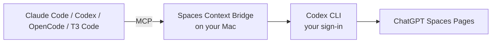

# Spaces Context Bridge

Read and edit your ChatGPT Spaces from Claude Code, Codex, OpenCode and other MCP clients.

Spaces Context Bridge runs on your Mac and connects your agents to the Pages already in your ChatGPT Spaces. Use the same project context across agents: search for a decision, read the source, or make a bounded edit without copying text between apps.

Your agent connects over MCP. The adapter calls Spaces tools through your signed-in Codex CLI and returns the result, without starting another model turn. You can connect each client directly or share one connection through Executor.

## What you can do

- **Find context:** list Spaces, search Pages and read their contents with source links.
- **Edit a Page:** replace one exact span in one block, checked against a fresh read and verified afterward.
- **Save notes:** create a Page containing selected notes or a transcript in a Space you choose, with duplicate protection for retries.

For example:

> Find the launch plan in my Product Space and summarize the open decisions with source links.

> In the Launch Plan Page, replace “Target date: October 20” with “Target date: October 23”. Leave everything else unchanged.

## Get started

You need **macOS, Node.js 22.13+, and the Codex CLI signed in with your ChatGPT account**, with Spaces tools available to that account in Codex. Codex provides the Spaces connection even when Claude Code or another client is doing the work.

```sh
git clone https://github.com/designxdevelop/spaces-context-bridge.git
cd spaces-context-bridge
npm run setup
npm start
```

No npm dependencies are required. Setup creates a private owner key and a read-only configuration; the server listens at `http://127.0.0.1:4791/mcp`.

1. [Connect your client](docs/CLIENTS.md) using the key as a bearer token. Keep it out of chat and committed configuration.
2. Ask your agent to list your Spaces. Reads work immediately if the source tools are available.
3. Stop the server, allow writes to the Spaces you choose, then restart:

```sh
npm run setup -- --allow-space page_space_EXAMPLE
npm start
```

`--allow-space` adds permissions; rerunning setup preserves existing permissions, the key and save journal. See [the setup guide](docs/DIRECT_SETUP.md) for configuration and removing permissions, or [set up with your agent](docs/SETUP_WITH_AGENT.md).

## Clients

[Client setup](docs/CLIENTS.md) includes Claude Code, Codex and OpenCode configuration. [T3 Code and Executor](docs/CLIENTS_T3_OPENCODE_EXECUTOR.md) covers sharing the connection across providers.

The T3 Code (Codex) → Executor → adapter path has been tested live. Other client configurations are documented but have not been tested live. Clients must run on the same Mac as the adapter; cloud app connectors cannot reach its loopback address.

## How it works



The adapter exposes a fixed set of tools and performs no model inference of its own. Observed reads and writes completed in seconds; timings are observations, not guarantees. The Mac must stay awake with the server running and Codex signed in. See [architecture and limits](docs/PRODUCT.md) and [test evidence](docs/RELEASE_REVIEW.md).

## Optional: meeting notes

Spaces access works without a recording app. If you use Superwhisper, connect its separate MCP server and ask your agent to save selected notes or transcripts into a named Space. ChatGPT Meetings list/fetch tools are also included when requested; fetching a real Meeting note remains unverified.

[Meeting setup](docs/DIRECT_SETUP.md#optional-meeting-sources) and [the agent prompt](prompts/DIRECT_AGENT_PROMPT.txt) cover source selection, citations and safe retries. Imports happen when requested; automatic recording sync is not included.

## Privacy and permissions

Pages live at OpenAI. Your agent and its model provider see the content you ask it to handle; edits and saves go through Codex back to Spaces. Meeting imports also send selected text to those providers. This is not local-only processing.

The adapter stores IDs, hashes and status in a private journal, without note text. Reads cover accessible current Space Pages; writes require an explicit Space allowlist. It has no delete, share, publish, move or messaging tools. Uncertain writes must be reconciled before retrying.

See [security](SECURITY.md) for trust boundaries and private reporting, and [operations](docs/OPERATIONS.md) for backup, upgrade, key rotation and uninstall instructions. Each installation uses its owner's accounts and storage; there is no service operated by the maintainers. Your ChatGPT and agent-provider terms and usage charges apply.

## Support and development

Use [GitHub Issues](https://github.com/designxdevelop/spaces-context-bridge/issues/new/choose) for setup questions, bugs and feature requests. Include versions and a synthetic reproduction, without keys, recordings or private links. Report vulnerabilities through [GitHub private reporting](https://github.com/designxdevelop/spaces-context-bridge/security/advisories/new).

Run `npm run verify` for automated tests and the release-hygiene scan. See [CONTRIBUTING.md](CONTRIBUTING.md).

MIT licensed, copyright 2026 Design X Develop. See [LICENSE](LICENSE). Independent of OpenAI, Anthropic and Superwhisper.
