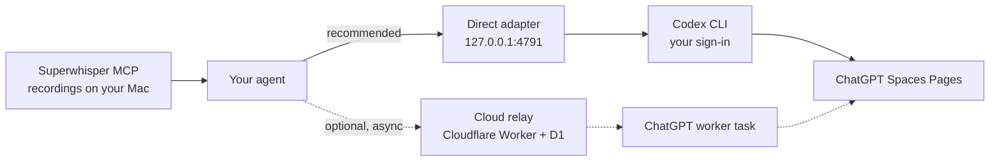

# Spaces Context Bridge

Let your coding agent read and update your ChatGPT Spaces, and save the meetings you record in Superwhisper there.

Spaces Context Bridge is a small open-source MCP server that runs on your Mac. Connect Codex, Claude Code, OpenCode or T3 Code to it, and your agent can look things up in your Spaces Pages, make a careful edit, or save meeting notes and transcripts into the Space you name. You run it yourself under the MIT license. There's no hosted service and no account to sign up for.

## Why it exists

I wanted a Granola-style setup built from tools I already use. Superwhisper records meetings on my Mac, ChatGPT Spaces holds the notes, and whichever coding agent I'm working in can pull that context or file new notes without me copying text between apps.

The first version sent every request through a queue to a ChatGPT cloud task, so each one took somewhere between 40 seconds and a few minutes. The direct adapter calls the same Spaces tools through the Codex CLI you're already signed in to, with no queue and no extra model turn. In testing, requests finished in seconds. See the [evidence](docs/PRODUCT.md#evidence).

## Quick start

You need macOS, Node.js 22.13 or newer, and the Codex CLI signed in with your ChatGPT account, with Spaces tools available to that account in Codex.

```sh
git clone https://github.com/designxdevelop/spaces-context-bridge.git
cd spaces-context-bridge
npm run direct:setup   # finds Codex, creates a private key and a read-only config
npm run direct:start   # serves http://127.0.0.1:4791/mcp in the foreground
```

Connect your agent with the key as a bearer token ([client configs](docs/CLIENTS.md#direct-adapter)). The T3 Code (Codex) → Executor route has been tested live; the other client configs are documented but not yet live-tested. Ask your agent to list your Spaces, then stop the server (Ctrl-C), allow writes to the Spaces you choose, and start it again:

```sh
npm run direct:setup -- --allow-space page_space_EXAMPLE
npm run direct:start
```

Add [the agent prompt](prompts/DIRECT_AGENT_PROMPT.txt) to your agent's standing instructions and ask:

> Save my latest meeting notes in Personal Notes.

[Direct setup](docs/DIRECT_SETUP.md) covers each step in detail. If you'd rather have your agent do the setup, use the [setup prompt](docs/SETUP_WITH_AGENT.md).

## What it does

- **Read.** List Spaces, list and search Pages, read a Page.
- **Edit.** Replace one exact span of text in one block of a Page, checked against a fresh read and verified afterward.
- **Save.** Create a Page with meeting notes or a transcript, verbatim, with a stable source ID so a retry doesn't create a duplicate.
- **Meetings.** Superwhisper, through its own MCP server, is the default source. ChatGPT Meetings list and fetch tools are also available when requested; fetching a real Meeting note remains unverified.

It won't delete, share, publish, move or message anything. It won't write to a Space you haven't allowed, sync recordings in the background, or forward arbitrary tool calls.

## How it works



Your agent decides what to do and calls the adapter's tools. The adapter makes a fixed set of Codex tool calls (six Spaces Page operations plus ChatGPT Meetings list and fetch), checks the results and returns them. It never starts a model turn of its own.

## Privacy

Your notes don't stay on your Mac. When you save a meeting, its text goes from Superwhisper to your agent's model provider, then through the local adapter and Codex to OpenAI, where the Page lives. Your agent's provider sees whatever you ask it to handle. The adapter keeps only IDs, hashes and status in a local journal, and its logs contain short categories, not content. It relies on Codex's own sign-in and doesn't extract those credentials. Details are in [operations](docs/OPERATIONS.md#direct-adapter) and the [security policy](SECURITY.md).

## Optional: cloud relay

The original route is still here. A Cloudflare Worker with a D1 database queues requests, and a ChatGPT cloud task picks them up. It can process Spaces requests while your Mac is asleep and from remote clients; reading local Superwhisper recordings still needs your Mac. It's asynchronous (expect roughly 40 seconds to a few minutes per request), it stores request payloads, including transcripts, in your D1 database, and it takes more setup. Use it as a fallback, not as the default.

[](https://deploy.workers.cloudflare.com/?url=https://github.com/designxdevelop/spaces-context-bridge)

The button deploys into your own Cloudflare account. The CLI deployment has been verified on fresh resources; the full browser-button flow hasn't yet. Then:

1. Follow [Cloudflare deployment](docs/DEPLOYMENT.md).
2. Connect your agent and the ChatGPT worker with [client setup](docs/CLIENTS.md#cloud-relay-clients-optional).
3. Set the owner scope in the [worker prompt](prompts/CHATGPT_WORKER_PROMPT.txt) and activate its `request.created` task.
4. Run the [acceptance checks](docs/VERIFICATION.md#cloud-relay-optional) with synthetic text before using real transcripts.

## Project status

MIT licensed, copyright 2026 Design X Develop. See [LICENSE](LICENSE). Every installation runs under its owner's accounts. The [product notes](docs/PRODUCT.md) cover how it works, what has been tested, and what hasn't. Spaces Context Bridge is independent of OpenAI, Anthropic, Superwhisper, Granola and Cloudflare.

## Support

Use [GitHub Issues](https://github.com/designxdevelop/spaces-context-bridge/issues/new/choose) for setup questions, bugs and feature requests. Include the version, client, setup step and a synthetic reproduction. Leave out keys, transcripts, notes and private links.

Report security vulnerabilities through [GitHub private vulnerability reporting](https://github.com/designxdevelop/spaces-context-bridge/security/advisories/new). See [SECURITY.md](SECURITY.md).
